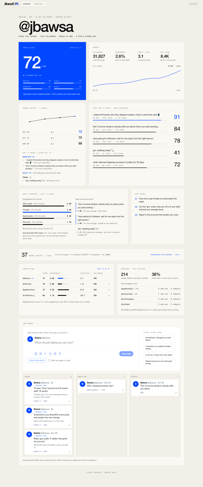
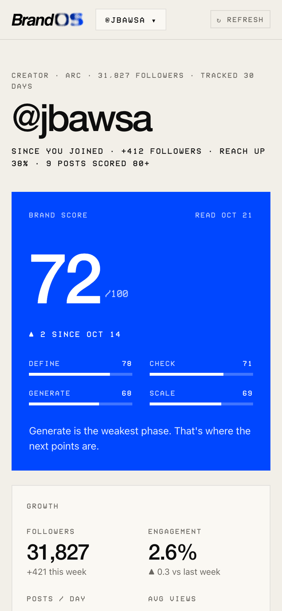

# Dashboard v2: Phase 0 audit and Phase 1 mockups

Written 27 Oct 2026 for Bawsa's approval. Brief: `docs/strategy/DASHBOARD-REDESIGN-PROMPT.md`.
**Status: design only.** Nothing in `/dashboard` has changed. Nothing is removed until Bawsa
approves the table in §3.

- Mockups (sample data, no sign-in, no API calls): `/world-preview/dashboard-v2`
  - `?s=today|playbook|canvas|write|framework|standing|press`
  - `&c=bone|night|klein|paper` sets the finish
  - `&first=1` is the first open ("which one are you?"), `&k=1` opens the command bar,
    `&chrome=0` hides the mockup bar
  - The black bar at the top of the page jumps between screens and finishes. ⌘K works too.
- Screenshots: all 9 screens, desktop and phone, in all four finishes (80 images), are in
  `marketing/dashboard-v2-mockups/` in the main checkout. Bone desktop and Night phone are
  committed in `docs/strategy/dashboard-v2-audit/mockups/`.

---

## 1. Today's dashboard (screenshots)

Sample-data harness `/world-preview/growth`. It renders the same `GrowthDashboard` component
that `/dashboard` renders for every Pro member.

| Desktop (full page) | Phone (first screen) |
| --- | --- |
|  |  |

Also captured: `current-dashboard-phone.png` (full phone page, about 7 screens tall),
`current-write-desktop.png` and `current-write-phone-night.png` (the copywriter at
`/dashboard/write`).

**What the audit found**

1. **It's a report.** There are 13 blocks on one long page: masthead, score, growth, score
   history, last 5 posts, what's working, next moves, lookups, competitors, audience, Index and the
   idea board. On a phone the first screen holds the handle and the score; the idea board, the
   only place you make something, is about 6 screens down.
2. **No action is the obvious one.** "Next moves" is a numbered list with no buttons. The only
   input on the page is the idea-board composer at the bottom.
3. **Finishes don't reach it.** `GrowthDashboard` and its parts hard-code the Bone palette
   (`T` in `src/components/growth/parts.tsx`). Bone/Night/Klein/Paper only work on the legacy
   bento and the copywriter. v2 has to fix this; the mockup proves the token approach
   (`src/app/world-preview/dashboard-v2/tokens.ts`).
4. **The workspaces are orphaned.** Nothing on the growth dashboard links to the copywriter
   (`/dashboard/write`), the calendar or import. A member only finds them by URL.
5. **XP and the streak are invisible.** `recordVisit` now runs on the growth path (in `after()`),
   so XP is earned, but the growth dashboard never shows XP, level or streak. The XP bar and the
   check-in moment exist only on the legacy bento.
6. **Steps from a cold open to the first useful action:** today, 4 on desktop (scroll about 2.5
   screens, find the composer, click, type) and about 6 swipes plus a tap on a phone. In v2 it
   is **1 tap**: "Start writing" opens the writing room with the draft started.

---

## 2. The new shape (what the mockups show)

```
            ⌘K  (everything secondary: brands, finishes, re-read, competitors, import)
             │
 Today ──► one move ──► Writing room ──► mark posted ──► Standing (+XP) ──► The Press
   │                        ▲  ▲                                              (day stamped
   ▼                        │  │                                               into the Record)
 Playbook (home) ── Canvas ─┘  └── Frameworks
   positioning · audience · voice · pillars · what's working · the Record · body of work
```

| Screen | Psychology principle | What got cut or moved |
| --- | --- | --- |
| **Today** (daily next move) | Remove the blank page, choice reduction: one move from the member's own Record, one Klein action, open loops as a gentle count | The 13-block report as the first screen (all of it is still one tap away) |
| **First open** | Personalization with one tap (creator / founder / builder) changes examples and moves only | No multi-step onboarding |
| **Playbook** (home) | Endowed progress + IKEA effect: pre-filled from the scan ("50% is yours"), every edit is stamped **Yours**; compounding made visible (Body of work) | Competitors, audience, lookups, Index tile move off home; the 4-stat Growth tile becomes one "since you joined" line |
| **Canvas** | Remove the blank page (a suggestion from the Record, linked to its source post), open loops (half-built cards wait in place). Phone: frames as a stack, long-press to connect | The 3-column Ideas/Drafting/Posted kanban; status becomes a tag |
| **Writing room** | Choice reduction + fast feedback: one idea, one editor; scoring sits beside the words; autosave shown as a word; undo on every change | The copywriter as its own chat page; X-composer chrome (avatar, fake toolbar) |
| **Framework** (2x2, before/after, loop, ladder) | Ideas as diagrams, radical simplicity: one idea per plate, one coral mark | New; kept to four shapes, no free drawing |
| **⌘K** | Choice reduction: secondary actions live here so each screen keeps one primary | Header buttons (refresh, add brand, add competitor) |
| **Standing** (the XP/level moment) | Peak-end + compounding: a counted win framed as work on the record; the run "rests", Standing never drops | Arcade XP bar, per-gain receipt list, streak-loss alerts |
| **The Press** (signature) | Peak-end + ownership: the session ends with today's cell pressed into a record you own, and the plate is the share card | The check-in modal |

### The signature moment: The Press

Your Record is a plate on the Klein field: one cell per day for 12 weeks, each a 1-bit dither
whose density is how much you made that day. When you finish a session, today's cell is
**pressed** in (the brand's stamp motion: 112% → 100%, a ring outward), it turns coral ("this
one", the one coral cell on the screen), and the machine types the entry line:
`27 OCT 2026 / 1 POST / 2 IDEAS / ENTERED`. The plate is the share image ("84 days on the
record"). It joins three things only BrandOS has: the field, the stamp and the record.

### Interaction and motion (as built in the mockup)

- Every button: press-in (scale 0.97, 1px down, ~120ms), spring release, a 2px focus ring in
  the finish's focus colour, at least 44px tall on phones (`Btn` in `ui.tsx`).
- One Motion+ headline per screen, always on the Klein signal: the move's number
  (`AnimateNumber`), the Record score, the draft's fit score, the Standing total, the Press's
  typed line (`Typewriter`). Everything else is small (settle, press, spring).
- `MotionConfig reducedMotion="user"`. Under reduced motion every number shows its final
  value, the press is instant and the line is printed.
- Keyboard: ⌘K anywhere; `g` then `t/p/c/w/f/r` jumps to a screen; on the canvas `N` adds a card, `C` connects,
  Delete removes (with undo), ⌘Z undoes, Esc deselects; in the writing room ⌘↵ scores, ⌘. hides the reading, Esc goes
  back to the Playbook.
- No confirm dialogs: every destructive or editing action shows a quiet toast with **Undo**.
- **AA contrast** in all four finishes: Klein text on Night is too dark (#0047FF on #161618 is
  about 2.9:1), so Night uses `#7C9DFF` for signal text (about 6.3:1). Muted type on the Klein canvas
  is white at 85% (about 4.9:1), not 75% (about 4.0:1). On the Klein finish, the primary action
  that sits on the canvas turns white (`--v-cta`), or it would melt into the ground.

---

## 3. Keep / merge / move / cut

Nothing is deleted from the data. Every row below is about where something **appears**.

### The growth dashboard (`src/components/growth/*`, live on `/dashboard`)

| Feature | Verdict | Where it goes | Why (one line) |
| --- | --- | --- | --- |
| Masthead (handle + VCR metadata line) | **Merge** | Playbook head | One line of facts; the handle is already in the rail |
| "Since you joined" proof line | **Keep** | Playbook head + Record plate | It's the ownership story in one line |
| Brand score tile (Klein, phases) | **Keep** | Playbook → The Record tile | The one Klein moment on home |
| Growth tile (4 stats + followers chart) | **Merge** | Record tile; the chart opens from "since you joined" | Four numbers and a chart is the "data report" feel; one line says it |
| Score history tile + "why it moved" | **Merge** | Inside the Record tile | History is only useful next to the score it explains |
| Your last 5 posts (PostScore rows) | **Move** | Playbook → What's working (detail), writing room reference | Useful while writing, noise on home |
| What's working (formats, peak hour, outlier, best/worst) | **Keep** | Playbook | Becomes "do more of this" with a button |
| Next moves (3-item list) | **Merge** | Today (one at a time, "Show another") | A list of three is a to-do list; one is a decision |
| Lookups ("looked up 37×") | **Merge** | Today's open-loop line + Record tile | A reason to come back, not a block |
| Competitors table + add competitor | **Move** | A Brand view via ⌘K ("Competitors and audience") | SMM-leaning; valuable, but not daily for a solo creator |
| Audience (who engages, amplifiers) | **Move** | Same Brand view | Same |
| Index tile | **Move** | Playbook (entry No. in the head) + rail item when the Index opens | The entry number already says it |
| Idea board: composer + stuck prompts | **Merge** | Canvas (new card) + writing room (starters) | One place to think, one place to write |
| Idea board: Ideas/Drafting/Posted columns | **Merge** | Canvas (status as a tag on the card) | Spatial grouping by pillar beats a status pipeline |
| BrandOS ideas (`/api/ideas/generate`) | **Keep** | Today's move + canvas suggestions | The engine behind "never a blank page" |
| X-style composer chrome (avatar, toolbar icons) | **Cut** | – | Decoration that pretends to be X |
| Draft score (`DraftScore.tsx`) | **Move** | Writing room, right side (phone: bottom sheet) | Feedback beside the words |
| Brand switcher + add brand | **Keep** | Rail (desktop), top chip + ⌘K (phone) | First thing an SMM touches |
| ↻ Refresh | **Move** | ⌘K "Re-read @handle" + Record tile | A secondary action |
| Early-access dock | **Keep** | As is until Nov 2 | Testers need it |

### Pages under `/dashboard`

| Page | Verdict | Why |
| --- | --- | --- |
| `/dashboard/write` (copywriter chat) | **Merge** into the writing room | The chat becomes one "Ask the copywriter" line beside the draft; formats become tabs under the editor |
| `/dashboard/calendar` | **Cut from nav** (keep the route) | The product map folds it into the coaching plan; it isn't a daily surface |
| `/dashboard/import` | **Move** to Settings / ⌘K | Used once |

### The legacy bento (`?design=v2`, `src/components/dashboard/*`)

| Component | Verdict | Why |
| --- | --- | --- |
| `XPBar` | **Merge** → Standing (rail mini + the Standing moment) | Keeps XP prominent but calm |
| `CheckinMoment` | **Merge** → The Press | Same job: the session's last frame |
| `ScoreCardShare`, `BrandPass`, `PassShare` | **Keep**, reached from the Record tile | The share loop |
| `DashSettings` (finishes) | **Keep** in Settings + ⌘K | Finishes must keep working |
| `ScoreDetail`, `PhaseDetail`, `ScanReport`, `ScanResultPanel` | **Move** → tapping the score | Depth on demand |
| `BrandDNAPanel` | **Merge** → Playbook (voice, pillars) | Same information, editable in place |
| `VoiceFingerprintPanel` | **Merge** → writing room "Sounds like you" | Useful only while writing |
| `ContentCheckPanel`, `DriftAlertsBar` | **Merge** → writing room score | Same job as draft scoring |
| `StatTiles`, `QuickStatsCard`, `RecentPostsCard`, `BrandFeedCard` | **Cut** | Duplicates of the Record and What's working |
| `BrandConsistencyChart`, `CalendarSummaryCard` | **Cut** | No daily decision rests on them |
| `LookupStrip` | **Merge** (see lookups above) | |
| `RescanOverlay`, `RescanOnLoad`, `BackupLoginNudge`, `Paywall`, `ConnectX`, `FirstScan` | **Keep** | Mechanics, not layout |
| `dashMotion` boot (`ScrambleLabel` on every label, stat `Ticker`, magnetic `DashCursor`) | **Cut** | Motion noise; one headline per screen instead |
| Dashboard layout `WorldScene` + `MuteButton` | **Cut** the scene on v2; the sound toggle moves to Settings | Decorative backdrop behind reading surfaces |

---

## 4. Terminal noise: what to dial back (about 15%)

**Keep (the character):**

- VCR micro-labels as **section markers**, one per panel: `POSITIONING`, `THE RECORD`,
  `TODAY'S MOVE`.
- Mono for **data that means something**: scores, `/100`, dates, `ENTRY No. 0042`,
  `CLASS 04 · ARC`, keyboard hints.
- Document head lines (`PLAYBOOK / ENTRY No. 0042 · UPDATED 27 OCT 2026`).
- The machine typing, but **only** in the Press line (BRAND-WORLD: "the machine shows only
  while it reads").

**Remove:**

| Element | Where today | Instead |
| --- | --- | --- |
| `// SECTION` comment prefixes | `BrandDNAPanel`, `VoiceFingerprintPanel`, `ContentCheckPanel`, `BrandSetupWizard` | Plain VCR label |
| `[ BUTTON ]` bracket buttons | `TerminalButton` (terminal-ui), wizard, voice, content check | Sentence-case pill buttons |
| ASCII bars `[████░░░░]` | `asciiBar` (terminal-ui) | 4–6px rounded bars |
| Blinking block cursor `█` | `Cursor` (terminal-ui) | Removed (the editor has a real caret) |
| Labels scrambling on every load | `ScrambleLabel` (dashMotion) | Still; only the headline moves |
| Stat ticker marquee | `StatTicker` (bento) | One "since you joined" line |
| VCR caps on buttons (`ADD →`, `WRITE →`, `↻ REFRESH`, `GET THE SCORE →`) | Growth dashboard, copywriter | Sentence case in the display face |
| VCR caps table headers and chart axis labels | Competitors, followers chart | Sentence case (the axis keeps one VCR date) |
| A masthead metadata line repeating the UI (`CREATOR · ARC · 31,827 FOLLOWERS · TRACKED 30 DAYS`) | Growth masthead | Classification + one proof line |
| `BRANDOS IDEA` tag on every card | Idea board | One "From your Record" marker per section |
| `▲ ▼` glyphs on every stat | Growth tile | Only on the score delta |
| Square 0-radius tiles with hard borders | Everywhere | 18px radius, inset hairline: calm, Things-like |

Net effect: the VCR + mono voice stays on every screen as markers and data; what goes is
decoration that repeats what the UI already says. The first screen goes from 13 blocks to 1
panel + 2 quiet lines.

---

## 5. Data and API map

Everything the mockups show is backed by data that already exists, except the five
"new" rows at the bottom.

| v2 surface | Reads (exists) | Writes (exists) | Gap |
| --- | --- | --- | --- |
| **Today: the move** | `DailyBrief` (one per user per day, `/today`), `BrandScan.nextMoves`, `PostScore` (reach multiple, fit), `AccountPost`, `Idea` (half-built), `/api/ideas/generate` | `DailyBrief.completedAt` | Move kind/source + "later" + persona (see new tables) |
| **Today: open loops** | `Idea` where `status in (saved, drafting)`, lookups (`BrandLookup`) | – | – |
| **Playbook: positioning / audience / voice** | `BrandScan.summary`, `insights`, `strengths`, voice fingerprint (`/api/voice-fingerprint`) | – | **Editable sections** (new table) |
| **Playbook: pillars** | `BrandScan.contentPillars` | – | Member edits + order (same new table) |
| **Playbook: what's working** | `getGrowthView` formats / best / worst / outlier, `PostScore` | – | – |
| **Playbook: the Record** | `BrandScan` history, `memberRecord().move`, phases | `/api/dashboard/rescan` | "Why it moved" diff (product map §4.2) |
| **Playbook: body of work** | `Idea.createdAt/status/postedAt`, `PostScore.postedAt`, `BrandScan.score` per week | – | A weekly roll-up query (no table) |
| **Canvas: cards** | `Idea` (per brand, `accountId`, mig 042) via `/api/ideas` | `/api/ideas` POST/PATCH/DELETE | **Position, frame, links** (new tables) |
| **Canvas: suggestion** | `/api/ideas/generate`, `PostScore` | `Idea` (`source='brandos'`) | – |
| **Writing room: draft** | `Idea.text` | `/api/ideas` PATCH (status `drafting`, text) | Autosave = the same PATCH, debounced |
| **Writing room: score** | `/api/dashboard/draft-score` | – (1h cache) | – |
| **Writing room: ask** | `/api/dashboard/copywriter` (stream) | – | Accept the current draft as context (server-side cap) |
| **Writing room: mark posted** | – | `/api/dashboard/idea-board` PATCH `posted` (+XP `ideaPosted`) | Unify `/api/ideas` and `/api/dashboard/idea-board` posted paths |
| **Frameworks** | `PostScore`, `Idea` (pre-fill) | – | **Saved frameworks** (new table); export is client-side SVG → PNG |
| **⌘K** | brands (`TrackedAccount`), finishes | `/api/me/preferences` (finish) | – |
| **Standing** | `UserProgress`, `XPEvent`, `levelFor()` | `recordVisit`, XP awards | – |
| **The Press** | `XPEvent`, `Idea`, `PostScore` grouped by local day | – | A per-day roll-up query (no table) |
| **First open: persona** | – | – | **Persona** (new column) |

### New tables (SQL proposals only, not migration files, not applied)

When Bawsa approves, these become `supabase-migrations/05x_*.sql`. Each follows the 036 pattern:
RLS on, no policies, anon/authenticated revoked, server-only through Prisma, idempotent. No
existing data moves: ideas, drafts, scores and XP stay where they are, and the new tables only
add to them.

```sql
-- 1. Persona: creator | founder | builder (first-open question, changeable in Settings)
ALTER TABLE "UserPreference"
  ADD COLUMN IF NOT EXISTS "persona" TEXT
  CHECK ("persona" IS NULL OR "persona" IN ('creator', 'founder', 'builder'));

-- 2. Playbook sections the member has made theirs (pre-fill stays derived from the scan;
--    a row exists only once a section is edited, so "yours %" = rows / sections)
CREATE TABLE IF NOT EXISTS "PlaybookSection" (
  "id"        TEXT PRIMARY KEY DEFAULT gen_random_uuid()::text,
  "accountId" TEXT NOT NULL REFERENCES "TrackedAccount"("id") ON DELETE CASCADE,
  "userId"    TEXT NOT NULL REFERENCES "User"("id") ON DELETE CASCADE,
  "kind"      TEXT NOT NULL CHECK ("kind" IN ('positioning', 'audience', 'voice', 'pillar')),
  "position"  INT  NOT NULL DEFAULT 0,          -- pillar order
  "body"      TEXT NOT NULL CHECK (char_length("body") <= 600),
  "createdAt" TIMESTAMPTZ NOT NULL DEFAULT now(),
  "updatedAt" TIMESTAMPTZ NOT NULL DEFAULT now()
);
CREATE UNIQUE INDEX IF NOT EXISTS "PlaybookSection_one_per_kind"
  ON "PlaybookSection" ("accountId", "kind", "position");

-- 3. Canvas: where an idea sits, in which frame, and what it connects to
CREATE TABLE IF NOT EXISTS "CanvasFrame" (
  "id"        TEXT PRIMARY KEY DEFAULT gen_random_uuid()::text,
  "accountId" TEXT NOT NULL REFERENCES "TrackedAccount"("id") ON DELETE CASCADE,
  "name"      TEXT NOT NULL CHECK (char_length("name") <= 80),
  "x" REAL NOT NULL, "y" REAL NOT NULL, "w" REAL NOT NULL, "h" REAL NOT NULL,
  "createdAt" TIMESTAMPTZ NOT NULL DEFAULT now()
);
ALTER TABLE "Idea"
  ADD COLUMN IF NOT EXISTS "x" REAL,
  ADD COLUMN IF NOT EXISTS "y" REAL,
  ADD COLUMN IF NOT EXISTS "frameId" TEXT REFERENCES "CanvasFrame"("id") ON DELETE SET NULL;
CREATE TABLE IF NOT EXISTS "IdeaLink" (
  "fromId"    TEXT NOT NULL REFERENCES "Idea"("id") ON DELETE CASCADE,
  "toId"      TEXT NOT NULL REFERENCES "Idea"("id") ON DELETE CASCADE,
  "createdAt" TIMESTAMPTZ NOT NULL DEFAULT now(),
  PRIMARY KEY ("fromId", "toId"),
  CHECK ("fromId" <> "toId")
);
-- (ideas with NULL x/y are laid out automatically on first open: nothing to backfill)

-- 4. Saved frameworks (the export itself is client-side)
CREATE TABLE IF NOT EXISTS "Framework" (
  "id"        TEXT PRIMARY KEY DEFAULT gen_random_uuid()::text,
  "accountId" TEXT NOT NULL REFERENCES "TrackedAccount"("id") ON DELETE CASCADE,
  "userId"    TEXT NOT NULL REFERENCES "User"("id") ON DELETE CASCADE,
  "kind"      TEXT NOT NULL CHECK ("kind" IN ('2x2', 'before', 'loop', 'ladder')),
  "title"     TEXT NOT NULL CHECK (char_length("title") <= 120),
  "labels"    JSONB NOT NULL,                    -- string[] (≤ 12 × 80 chars, checked in the API)
  "ideaId"    TEXT REFERENCES "Idea"("id") ON DELETE SET NULL,
  "createdAt" TIMESTAMPTZ NOT NULL DEFAULT now(),
  "updatedAt" TIMESTAMPTZ NOT NULL DEFAULT now()
);

-- 5. The daily move reuses "DailyBrief" (already one row per user per day)
ALTER TABLE "DailyBrief"
  ADD COLUMN IF NOT EXISTS "account_id"   TEXT REFERENCES "TrackedAccount"("id") ON DELETE CASCADE,
  ADD COLUMN IF NOT EXISTS "kind"         TEXT,     -- build | post | fix
  ADD COLUMN IF NOT EXISTS "source"       JSONB,    -- { postScoreId?, ideaId?, phase? }
  ADD COLUMN IF NOT EXISTS "deferred_at"  TIMESTAMPTZ;  -- "Later"

-- every new table:
-- ALTER TABLE public."<T>" ENABLE ROW LEVEL SECURITY;
-- REVOKE ALL ON TABLE public."<T>" FROM anon, authenticated;
```

Each new write route needs the usual guardrail: auth, the brand in the caller's own workspace,
length caps, per-user rate limits, and `test:rls` + `test:safety`.

---

## 6. Build slices and the Nov 2 deadline (honest read)

Today is 27 Oct, so there are 6 days. Every slice sits behind `DASHBOARD_V2`, so the launch can
fall back to today's dashboard.

| Slice | Needs a migration? | Size | Before Nov 2? |
| --- | --- | --- | --- |
| 1. Calm-down pass + Today's move (tokens/finishes on growth, the move from `DailyBrief` + next moves, open loops, ⌘K-less) | No (persona in `localStorage` until mig 1) | M | **Yes** |
| 2. Playbook home, read-only (pre-filled sections, Record tile, what's working, body of work) | No | M | **Yes** |
| 3. Writing room (moves draft score + copywriter; idea text autosave via `/api/ideas`) | No | M | **Likely**, if 1–2 land by Oct 30 |
| 4. ⌘K command bar | No | S | **Yes** (client-only) |
| 2b. Playbook editing ("Yours") | Yes (#2) | S | After Nov 2 |
| Standing moment + The Press | No (roll-ups over `XPEvent` / `Idea` / `PostScore`) | S–M | Nov 3–9 |
| 5. Frameworks (+ PNG export) | Yes (#4) to save; export works without | M | Nov 9–15 |
| 6. Canvas (desktop board + phone stack) | Yes (#3) | L | Nov 16–22 |

---

## 7. Open questions for Bawsa

1. **Standing vs XP/levels.** BRAND-WORLD says XP becomes Standing, "a rank, not a game
   bar", and bans "level up". The brief says XP, levels and streaks stay prominent. The mockup
   shows Standing points + Level 7 + Rank II · Noted, with no "level up" copy. Is that the
   right blend?
2. **The field.** Direction 03 puts the Klein field behind everything, with bone panels. The
   mockup keeps the four finishes as grounds and uses the field only for the Record plate (The
   Press). Should v2 sit on the field, or is that a later chapter (BRAND-WORLD puts the dashboard
   in Chapter 4, Dec–Jan)?
3. **Timing.** BRAND-WORLD says "before Nov 2, only Chapter 0". Shipping slices 1–4 behind a
   flag (default off for the public, on for testers) keeps the launch safe. OK to go that way?
4. **Competitors and audience** move off home into a Brand view. For SMM/agency members
   (Team $99 / Agency $249) is that a demotion you're happy with, or should SMM workspaces
   keep them on the Playbook?
5. **Persona.** One tap: creator / founder / builder. Should "founder" also switch the first
   brand's `kind` to `brand`?
6. **The Press share card.** Is the 84-day dither plate something you'd want public (e.g. on
   `/@handle`), or private-only with a share button?
7. **Calendar.** OK to drop it from navigation now (route kept) until the coaching plan?
